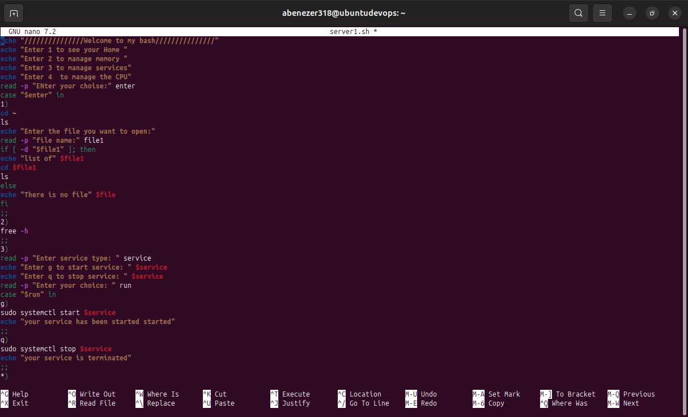

# Linux Server Audit

<p align="center">
  
  
</p>

A beginner-friendly Linux system monitoring project
built with Bash scripting on Ubuntu.

## Features
- file management
- CPU monitoring
- Memory monitoring
- service management

## Tasks Completed

1. created case statement for users option
2. in option 1 a simple file management with if statement 
3. in option 2 to check the memory usage
4. in option 3 a simple service manager automation
5. in option 4 a CPU monitering command

## Technologies
- Ubuntu Linux
- Bash scripting
- Linux commands

## Project Screenshot



## How to Run

```bash
chmod +x server-manager.sh
./server-manager.sh